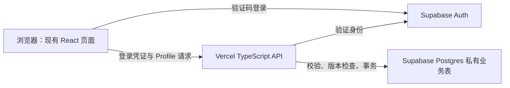

# 下一阶段最小实施计划：云端 Profile

日期：2026-11-07（America/Los_Angeles）  
状态：M2.1 代码与非变更型回归已审查，云端 Auth / 两用户 / SMTP 验收待完成；M2.2/M2.3 仍未授权，正式部署未授权。见 [范围](m2-1-scope-and-acceptance.md) 与 [实际验收记录](m2-1-validation.md)。  
项目：`/Users/shuaiyuan/Dropbox/Mac/Documents/ChatGPT/career-twin1`

## 1. 交付目标和范围调整

下一阶段建议称为 **M2：云端 Profile**。用户可以登录，在一个浏览器建立和维护 Profile，保存后换浏览器或电脑登录同一账号，继续使用同一份资料。

这是对原 M2 范围的规划修订：保留原来的日常可靠性、备份导出和恢复，加入登录、用户隔离与云端持久化。原计划全文及 M0/M1 的验收记录保留；当前只执行另行授权的 M2.1，其余仍为规划。M1 的真实经历试用仍有价值，不作为云端架构已验证的证据。

产品继续只服务 Profile Builder 和 Maintenance。用户原文仍是资料来源；现有项目编辑器、Save as new、Overwrite existing、元数据补充、全文浏览、删除和 Basic Info 保持原有语义。普通项目沿用现有中英文混合 500 单位规则，Basic Info 不受该上限约束，手动维护不调用模型。

## 2. 最小用户能力

| 能力 | 本阶段的最小交付 |
| --- | --- |
| 账号 | 邮箱验证码注册/登录、退出、会话恢复与过期处理；显示当前账号 |
| 云端维护 | 现有全部项目与 Basic Info 操作通过后端保存，云端提交成功才显示成功 |
| 跨设备 | 设备 A 保存后，设备 B 登录或刷新能够读取；返回页面/重新聚焦时检查更新，有草稿时保留草稿 |
| 保存可靠性 | 网络失败保留输入；重复点击、超时重试不重复写入；过期版本提示冲突，不静默覆盖 |
| 用户隔离 | 每人一份私有 Profile，接口和数据库均按已验证身份隔离资料 |
| 本地资料迁入 | 当前新版本地资料可导出、在云端登录后明确预览和确认迁入；本地原件保留 |
| 备份和恢复 | 版本化 JSON 导出；恢复前预览、确认，只替换当前账号的 Profile，一次事务完成 |

首版采用**联网保存、明确点击保存**。跨设备一致性指已提交资料的一致读取，不包含实时共同编辑、离线写入队列或自动合并草稿。断网时明确提示尚未保存到云端。

## 3. 建议技术方案

当前已保留 React/Vite，并按 M2.1 引入 Supabase Auth、独立开发数据库及本地 API。Vercel 入口仅准备为兼容代码，没有正式部署；完整云端编辑闭环仍属后续阶段。

| 层 | 建议 | 与当前代码的关系 |
| --- | --- | --- |
| 页面 | 保留 React + TypeScript + Vite | 沿用当前编辑器、列表、Basic Info 与计数函数 |
| Web 托管与 API | Vercel 前端托管 + 小型 TypeScript Functions | 在现有工程增加受认证保护的 Profile API |
| 身份认证 | Supabase Auth 邮箱验证码 | 增加登录态，稳定用户 ID 用作资料归属依据 |
| 持久化 | Supabase Postgres | 私有业务表、事务、用户隔离和版本检查 |

Vercel 的 Vite 集成支持同项目的 API Functions，适合保留当前工程并加入后端。此处使用 API 的具体理由是复用现有 TypeScript 的计数与校验，并集中处理事务、身份和重试；当前 React 页面继续沿用。[Vite 官方部署说明](https://vercel.com/docs/frameworks/frontend/vite)

业务表通过后端访问，浏览器只调用登录服务和 Profile API。前端和后端共用计数、名称回退与年份校验；直接绕过页面调用 API 也不能跳过规则。

### 邮箱登录的实际前提

默认采用邮箱验证码，首次验证后建立账号；同一账号跨设备登录得到同一用户 ID。验证码过期、重新发送和发送失败有明确反馈，不把邮件发送成功当作登录成功。[Supabase 邮箱验证码说明](https://supabase.com/docs/guides/auth/auth-email-passwordless)

正式试用需配置可用的自有 SMTP 服务并实际验证收信。Supabase 默认发信服务仅适合受限测试；当前新免费项目使用默认 SMTP 时，还存在验证码邮件模板自定义限制，因此不能把默认邮件服务当成上线方案。[SMTP 官方说明](https://supabase.com/docs/guides/auth/auth-smtp)、[邮件模板变更说明](https://supabase.com/changelog/46599-changes-to-email-template-customisation-on-free-tier)

### 身份和数据访问边界

- API 使用认证服务验证登录凭证，从已验证身份取得用户 ID；请求体里的账号/owner 字段不能决定数据归属。
- 普通业务请求使用最小权限数据库角色；用户上下文只在当前事务内有效，连接池复用时不得残留上一个用户的身份。
- 业务表放在不向 Data API 暴露的 schema，关闭本阶段不使用的 Data API；浏览器不能直接写表，避免绕过共享 TypeScript 校验。[Supabase API 边界说明](https://supabase.com/docs/guides/api/securing-your-api)
- API 授权与数据库行级权限一起保护用户资料。运行角色不能是表所有者、超级用户或带 BYPASSRLS 的角色；具体角色与事务上下文配置必须通过两用户实测，不能把“已开启 RLS”当成已经隔离。[PostgreSQL 行级权限说明](https://www.postgresql.org/docs/current/ddl-rowsecurity.html)
- 数据库连接串和服务端密钥只留在后端配置；日志不输出原文、验证码或访问令牌。
- Functions 使用适合短连接的连接池，并在同一事务里完成用户上下文和读写，配置需遵守连接池的会话状态限制。[连接池官方说明](https://supabase.com/docs/guides/database/connecting-to-postgres)

## 4. 最小数据与保存协议

延续 `project` / `basic_info`、稳定 ID、原文、名称、单位、年份/至今和时间字段。不引入技能、论文、事实审核或下游分析结构。

建议只增加三类后端数据：

1. **用户的 Profile 状态**：用户 ID、整体 `revision`、最近提交时间。
2. **Profile 记录**：以 `(owner_id, id)` 标识记录。普通项目 ID 保留现有 `project:<uuid>`；Basic Info 仍为 `basic_info`，但唯一性限定在各自用户内，避免不同账号争用同一个全局 ID。
3. **写入去重凭据**：按用户和操作 ID 记录请求摘要与已提交结果，供响应丢失后安全重试；不把整份原文复制到操作日志。

首版采用 **Profile 整体版本检查**，便于把普通保存、删除、迁入和整份恢复统一在可靠的事务边界内。不同设备修改不同项目也可能得到冲突提示，这是明确采用的保守默认；逐记录合并以后按实际需求再设计。

每次写入携带用户看到的版本和稳定操作 ID。后端先判断该操作是否已提交，再在事务中检查版本、执行变更、增加版本并记录结果。事务提交后才返回成功。

- 请求超时但实际已经提交：同操作 ID 重试返回原操作结果，不再次新建或重复删除。
- 相同操作 ID 带不同内容：拒绝，不把它解释为另一条新请求。
- 版本已过期：返回冲突，当前原文/元数据草稿保留，允许查看最新资料并明确重新提交。
- 被另一设备删除的目标：提示已不存在，不悄悄重新创建。
- 备份导出读取同一个一致快照；批量恢复同样检查整体版本，避免覆盖预览期间另一设备的新修改。
- Basic Info 保持每账号至多一条；服务器不对它套用普通项目的 500 单位校验。

服务器负责正常云端写入的时间和版本。迁入/恢复保留备份的原文、记录 ID 和有效的业务元数据（包括原记录时间），云端事务版本与提交时间重新生成。备份格式有独立版本，不包含令牌、数据库密钥或可用于指定另一用户的 owner 身份。

## 5. 云端为资料源，避免双写混乱

登录后的 Profile 以云端为正式资料源。本阶段 IndexedDB 不再同时承担另一套可修改的云端镜像；仅为已有新版资料提供只读导出/迁入通道。尚未提交的编辑内容先留在当前页面，保留已有的离开/刷新提示。

登录过期时保留当前用户的未保存输入，重新登录同一账号后可继续提交。切换账号或明确退出时，先处理草稿，再清空页面中的前一账号资料；退出前发出的迟到响应不得显示在下一账号的页面上。草稿与加载结果均绑定其所属用户。

跨设备读取采用登录、进入页面、刷新或窗口重新聚焦时检查最新版本。存在草稿时，不用新读取结果直接替换输入框；后台更新和用户输入分别处理。

## 6. 新版本地资料安全上云与备份

当前 `127.0.0.1:5181` 的 IndexedDB 和未来云端站点不属于同一 origin，云端站点不能自动读取原来的本地资料。因此迁入使用明确的文件通道：

1. 在当前新版本地地址提供只读导出，读取 `careertwin1-profile`，下载版本化 JSON；不需要先把本地内容写入任何云端账户。
2. 在云端站点登录，选择该文件，预览项目数量、Basic Info 与目标账号。
3. 空 Profile 可确认迁入；已有云端资料时进入明确的“恢复并替换”流程，先提供当前云端备份导出，不自动合并或覆盖。
4. 检查版本、字段、项目计数规则和 Basic Info 唯一性；所有记录一次性提交，保留稳定 ID。
5. 重试不产生重复项目；失败保留现有云端资料和本地原件。成功也不自动删除本地原件。

导出和恢复都只操作当前登录者的 Profile。无效 JSON、不支持的格式、超限项目、重复 ID、并发冲突或事务失败都不得造成部分替换。旧 CareerTwin 的数据库、资料迁移和兼容模型继续不在范围内。

JSON 导出/恢复不等于编辑历史、回收站或平台灾难恢复。首版不建立历史版本界面；云资源的数据恢复能力和费用在配置时单独确认。

## 7. 按三个小步骤实施和验收

| 顺序 | 实施范围 | 完成边界 |
| --- | --- | --- |
| M2.1 账号与私有后端 | 登录/退出/会话、私有表、最小 API、身份与数据库权限、测试环境配置 | 两个测试用户都能登录；任何路径都不能访问对方资料；服务端规则不能被绕过 |
| M2.2 云端 Profile 闭环 | 把现有 Profile 操作接到云端 repository；版本与去重；草稿/登录失效/切账号处理 | 设备 A 保存、设备 B 读取修改、A 刷新可见；冲突与失败不丢原文、不重复记录 |
| M2.3 迁入、备份与试用交付 | 新版本地导出、确认迁入、云端导出/恢复、真实浏览器与手机宽度验收 | 本地资料无损迁入；备份在独立测试账号恢复可核对；可开始受控跨设备真实使用 |

本阶段最先实现 M2.1，不同时重写页面或引入下游功能。每一步完成实际验证后再推进下一步。真实使用的问题在相应步骤修复，不靠继续添加功能掩盖。

部署准备纳入对应步骤：本地/测试与正式数据库隔离，预览不连接正式个人资料，登录发信和回调配置正确，服务端密钥仅在服务器环境。先在测试环境完成验收，再作正式发布决定。创建资源、启用收费方案、远程 push 或正式部署都不属于本次规划执行。

## 8. 阶段验收清单

- [ ] 同一账号在两个浏览器和两台设备可看到同一份已保存资料，退出/重开后仍可继续。
- [ ] 两个独立账号分别建立项目和 Basic Info，枚举/伪造记录 ID、owner、导出和恢复请求均不能越权；数据库权限独立验证。
- [ ] 原 M1 的新增、可跳过补充、指定覆盖、名称保留、统一 Edit、删除确认、全文与 Basic Info 行为全部保留。
- [ ] 直接调用后端也遵守原文保留、项目 500 单位、Basic Info 不限于 500、年份和类型规则。
- [ ] 模拟事务成功但响应丢失、连续点击、重试：只出现一次实际写入。
- [ ] 同时编辑、删除后再保存、预览后再恢复发生版本冲突时，不覆盖另一设备修改，当前草稿仍可取回。
- [ ] 保存失败/断网/会话过期只显示实际状态；账号切换和迟到响应不会串资料。
- [ ] 本地新版迁入不改动原库，恢复无部分写入；备份逐条核对原文、ID、单位、年份、时间和 Basic Info。
- [ ] Chrome 与另一种主流浏览器、桌面与手机宽度完成实际操作，登录邮件实际可收取。
- [ ] 用户完成一次真实 Profile 建立、换设备继续修改及一次备份/恢复试验；记录问题和验收结论。

已有 M1 的 57 项测试和 12 个浏览器场景是回归基线，不代表云端行为已通过。M2.1 已增加认证、权限和上下文隔离检查；实际通过项、skip 与待配置项以 [独立验收记录](m2-1-validation.md) 为准。幂等、版本冲突和跨设备编辑属于后续阶段。

## 9. 本阶段明确不做

职位分析、match score、简历生成、简历文件导入、雇主分享、LLM 调用、技能/论文/逐事实审核，以及旧版 CareerTwin 数据迁移均不启动。

账号首版只选择一种邮箱验证码流程；社交登录、团队/组织、计费、原生手机应用、离线自动同步、实时协作、自动冲突合并和历史版本产品界面不在最小范围。

## 10. 实施启动前需落定的配置

这份计划已经给出功能默认，不要求为每个实现细节重新确认。启动实施时再确定：

- 使用的 Vercel/Supabase 账号与项目归属、SMTP 发信账号和正式访问地址。
- 目标用户主要区域、数据地域与预算上限，函数和数据库尽量就近配置。
- 试用用户范围与发信/请求额度；核对实际套餐的数据备份能力，不假设全部永久免费。
- 云资源配置和代码完成可审查的结果后，再决定正式发布；密钥通过受控环境配置，不写入源码或聊天。

用户已另行明确授权 M2.1，并指定 Claude 实现、Codex 协调和独立审查；当前文件归属由编号交接 / ACK 确认。该授权不扩展到 M2.2/M2.3、DNS 修改、付费升级或正式部署。

平台核对基于本日的官方文档与 Supabase changelog。已核对的当前变化包括新项目邮件模板/SMTP 限制、Data API 暴露配置及连接池限制；真正实施前仍需按所选 SDK/CLI 版本复核。首次读取 changelog Markdown 时浏览工具不支持其 content-type，已改读官方 HTML 及相关变更页完成核对。
